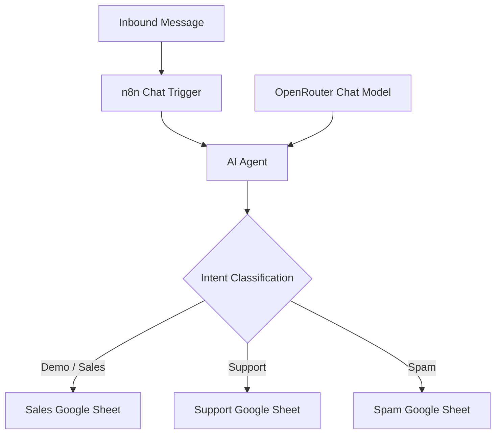

# System Architecture

## 1. Objective

Use an LLM-powered agent to classify inbound messages, extract relevant information, and route each message to the appropriate Google Sheets destination.

## 2. Architecture

## 3. Component Responsibilities

| Component | Responsibility |
|---|---|
| n8n Chat Trigger | Receives the message |
| AI Agent | Interprets intent and selects the appropriate tool |
| OpenRouter Chat Model | Provides LLM-based language understanding |
| Google Sheets tools | Store messages in the designated destination |
| n8n execution history | Supports troubleshooting and verification |

## 4. Data Flow

1. Receive an inbound message.
2. Interpret its meaning and identify its intent.
3. Extract available fields such as name, email, summary, and priority.
4. Select the corresponding Google Sheets tool.
5. Write the record and inspect the execution result.

## 5. Design Boundaries

**Current prototype:** Uses an AI Agent, an OpenRouter chat model, and three Google Sheets tools.

**Hardening requirements:** Validate the model's classification and extracted fields, define ambiguous-message handling, and implement duplicate-write protection and failure recovery.

The architecture should not be considered production-ready until these controls have been implemented and tested.
