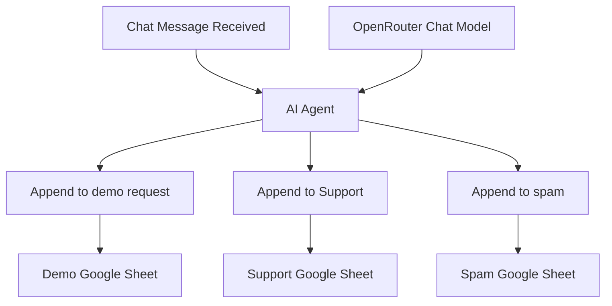

# System Architecture

## 1. Objective

Automate inbound message classification and destination selection using an LLM-powered agent orchestrated in n8n.

## 2. Architecture Diagram

The diagram shows available tool connections, not simultaneous execution. The system prompt instructs the agent to select one destination tool.

## 3. Components

| Component | Responsibility |
|---|---|
| Chat Trigger | Receives the inbound message |
| AI Agent | Interprets intent, extracts fields, and selects a tool |
| OpenRouter Chat Model | Provides language understanding |
| Google Sheets tools | Append records to the configured destination tabs |
| n8n execution history | Helps inspect workflow execution and troubleshoot failures |

## 4. Data Flow

1. Receive the message through the chat trigger.
2. Pass the message to the AI Agent.
3. Use the connected language model to interpret its intent.
4. Select the relevant Google Sheets tool.
5. Append destination-specific fields to the corresponding sheet.
6. Return a confirmation based on the tool execution outcome.

## 5. Current Design Boundaries

**Implemented in the exported configuration:**
- One chat trigger connected to an AI Agent.
- One OpenRouter chat model connected to the agent.
- Three Google Sheets append tools.
- Destination-specific field mappings.
- Prompt-based intent and routing instructions.

**Not established by the exported configuration:**
- Enforced structured-output validation.
- A separate human-review or clarification path.
- Explicit idempotency or duplicate-write prevention.
- A verified retry and recovery strategy.

## 6. Security

Before publishing the workflow, remove sensitive information and environment-specific configuration where appropriate. Configure credentials securely in the target n8n instance.

## 7. Scalability Considerations

Google Sheets is suitable for a lightweight prototype. If volume or reliability requirements grow, evaluate stronger storage, explicit validation, and controlled routing outside the LLM.
