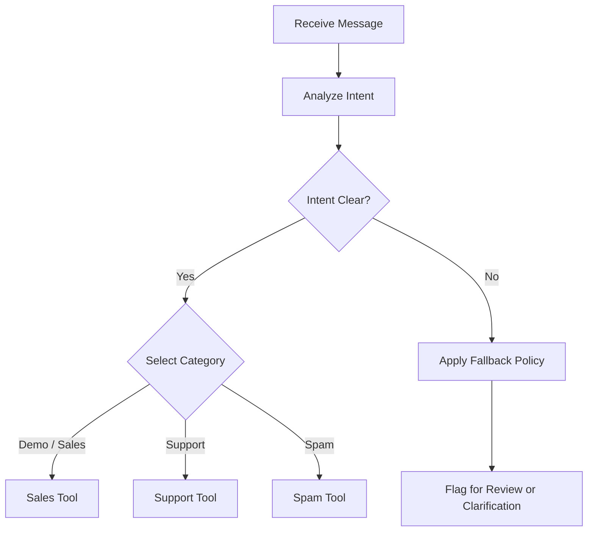

# Routing Decision Logic

## 1. Objective

Route each inbound message to one appropriate destination based on its intended meaning, rather than relying solely on keywords.

## 2. Intent Taxonomy

| Intent | Indicators | Destination |
|---|---|---|
| Demo / Sales | Product demo, pricing, purchase inquiry, sales conversation | Sales sheet |
| Support | Technical issue, product defect, troubleshooting, account problem | Support sheet |
| Spam | Unsolicited promotions, suspicious offers, irrelevant bulk messages | Spam sheet |

Classify based on the message's overall intent. A keyword alone should not determine the destination.

## 3. Decision Flow

## 4. Extraction Rules

Extract the following fields when available:

- `name`
- `email`
- `intent`
- `summary`
- `priority`
- `message_id`
- `received_at`

Do not invent missing information. Use a consistent representation for unavailable values.

Priority should follow documented criteria. For example, an issue preventing a customer from accessing a core service may be High priority; ordinary questions may be Normal priority.

## 5. Single-Action Requirement

For each message:

1. Determine one primary intent.
2. Select one corresponding destination.
3. Execute only the intended write.
4. Verify the outcome.

The AI Agent's tool selection alone does not guarantee exactly one write. Retries, repeated message delivery, or partial failures can create duplicates. Enforce this requirement through workflow validation and idempotency controls.

## 6. Ambiguous Messages

If a message combines multiple intents, select the primary intent using a documented precedence rule or send it for review. If the intent cannot be determined confidently, do not silently guess; use the configured fallback.

**Implementation status:** Confirm whether confidence checks, fallback handling, and single-write enforcement exist in the current n8n workflow before describing them as implemented.
