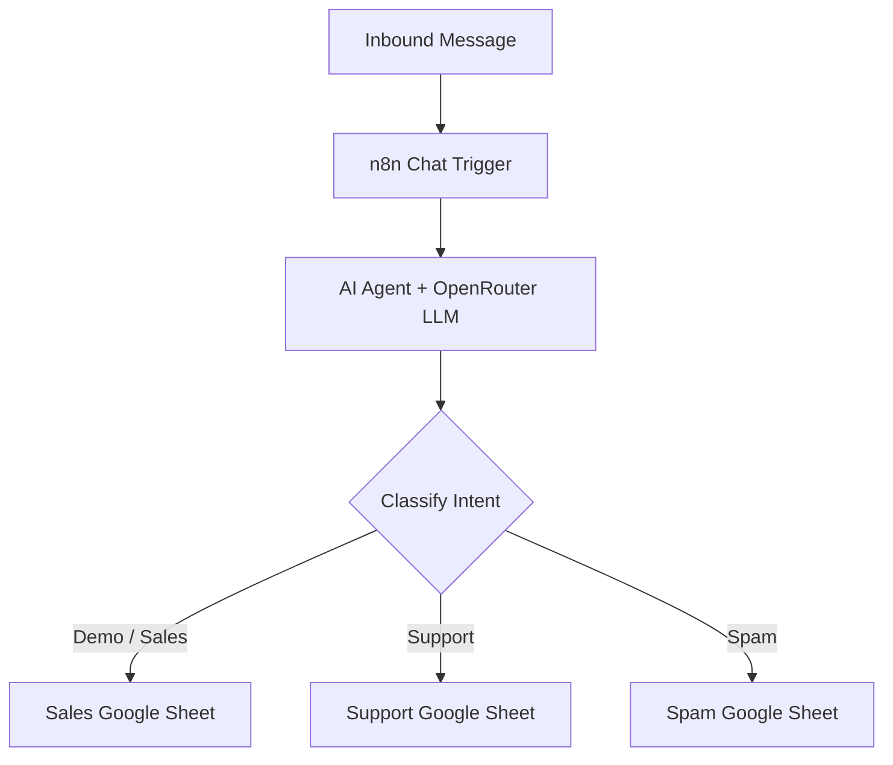

# Intelligent Message Routing Agent

**LLM-Powered Intent Classification and Workflow Automation**

## 0. Demo Video

Watch the workflow demonstration: [Intelligent Message Routing Agent — Demo Video](https://drive.google.com/file/d/1Am6hdrIeOCMiCb31CuQor5tdtPwIZ0XW/view?usp=drive_link)

## 1. Overview

An AI-powered agent that classifies inbound messages, extracts key information, and routes each message to the appropriate Google Sheets destination using n8n.

**Problem:** Manually reviewing and categorizing inbound messages is time-consuming and can lead to inconsistent routing.

**Solution:** Use an LLM-powered agent to understand message intent and automate routing to the appropriate destination.

## 2. Workflow Architecture

## 3. Technology Stack

- **Orchestration:** n8n
- **AI:** OpenRouter LLM and AI Agent
- **Data storage:** Google Sheets
- **Version control:** GitHub

## 4. Key Capabilities

- Classifies messages into Demo/Sales, Support, or Spam.
- Extracts relevant information, including name, email, summary, and priority.
- Routes each message to its intended destination.
- Uses a single-action routing requirement to avoid multiple destination writes.

## 5. Success Metrics

Proposed evaluation targets (not yet validated):

| Metric | Target |
|---|---:|
| Intent classification accuracy | ≥95% |
| Routing accuracy | ≥99% |
| Duplicate actions | 0 |
| Required-field completeness | ≥98% |

## 6. Reliability Considerations

Key areas for validation include ambiguous messages, missing fields, retries, duplicate writes, and incorrect classifications. Reliable single-action execution requires appropriate validation and duplicate-handling controls beyond the LLM prompt alone.

## 7. Product Decisions

- **LLM vs. keyword rules:** Use semantic understanding for varied, unstructured messages.
- **n8n vs. custom code:** Accelerate prototyping through visual orchestration and integrations.
- **Google Sheets:** Keep the prototype simple and make routed records easy to inspect.

## 8. Current Status

**Working prototype.** Further testing is needed to validate routing accuracy, field completeness, and duplicate-action prevention before considering production use.

## 9. Next Steps

1. Test representative messages across all three intent categories.
2. Measure actual performance against the proposed targets.
3. Add validation, failure handling, and duplicate-write protection.
4. Document findings and improvements.

---

**Product takeaway:** This project demonstrates how to translate an unstructured business workflow into an AI-assisted routing system, with measurable outcomes and explicit reliability requirements.

**Author:** Karthik  
**Portfolio:** [ai-product-leadership](https://github.com/Karthik-pmlead/ai-product-leadership)
