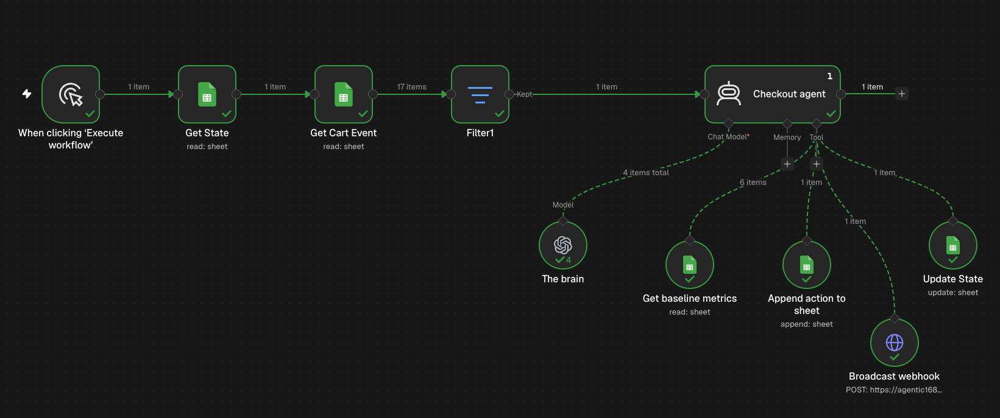

# Demo Evidence

## Demo Video
[Watch the 1-minute demo](YOUR_DEMO_VIDEO_URL)

## Workflow Screenshot

## Evidence
- n8n workflow execution
- AI-generated `ALERT` / `LOG` commands
- Google Sheets command records
- Webhook request and response

## Business Impact

**Intended value**
- Detect potential checkout incidents earlier.
- Standardize incident classification and escalation.
- Reduce manual monitoring and triage effort.
- Improve traceability through structured command logs.

## Key Takeaways
- **Agentic AI:** Connects event evaluation with downstream actions.
- **Decision intelligence:** Uses baseline metrics and explicit incident rules.
- **Workflow orchestration:** Integrates n8n, Google Sheets, and an HTTP webhook.
- **Operational reliability:** Requires idempotency, retries, and safe checkpointing.
- **Scalability Without Headcount:** Handle 10× checkout volume growth without adding monitoring staff

## Best Practices
- Define measurable thresholds and evaluation windows.
- Validate agent decisions against representative test cases.
- Enforce payload schemas and stable command IDs.
- Track webhook outcomes and handle failures explicitly.
- Prevent checkpoint advancement when processing is incomplete.
- Protect credentials, webhook URLs, and sensitive event data.
- Measure business outcomes before claiming ROI.

## Evidence Checklist
- [ ] Workflow execution captured
- [ ] `ALERT` and `LOG` outputs demonstrated
- [ ] Google Sheets command records verified
- [ ] Webhook delivery response captured
- [ ] Test results and limitations documented
